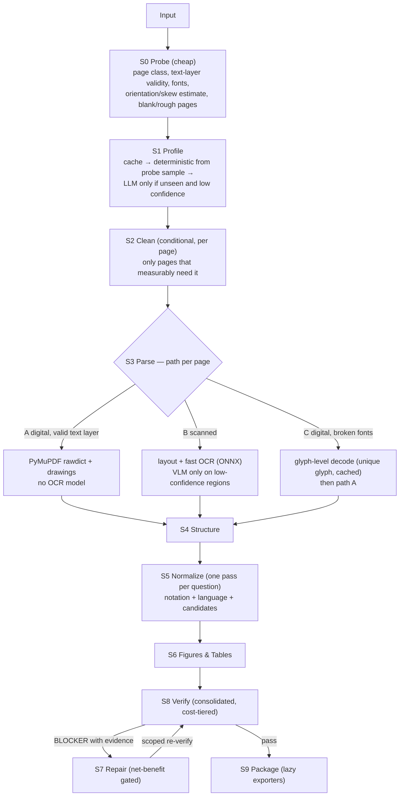

# ExamForge v2 — Optimisation & Simplification Plan (for the IDE agent)

> **Problem statement:** ExamForge v2.0 is slow, uses too many system resources, and is not accurate enough.
> **Mission:** make it **fast**, **lean**, **more accurate**, and **no more token-hungry** — by *measuring first*, then removing redundancy and moving models out of the hot path.
> **Source of this plan:** the architecture map of v2.0 only (no profiling data, no code). Every finding in §2 is therefore a **hypothesis to confirm in Phase O0**, not a verdict. Do not skip O0.

---

## 0. Rules for this plan

1. **Measure → change → re-measure.** No optimisation without a before/after number in `docs/PERF.md`.
2. **Do no harm.** Accuracy metrics (sequence accuracy, CER, figure IoU, table accuracy, language completeness) may not drop more than 0.5 pp on any suite. Speed work must keep the characterization/gold output **bit-identical** unless the change is explicitly an accuracy fix.
3. **One change per commit**, message `O<phase>.T<task>: …`, tests first (red → green), `make verify` clean.
4. **Delete only with proof.** Removal requires coverage evidence (module never executed on gold runs) plus a green full evaluation. Deleted code stays in git history; tag before deleting.
5. **All thresholds are proposals** relative to the O0 baseline; calibrate after O0 and record in `metrics/thresholds.yaml` (tighten freely, never loosen without a human-approved `BLOCKERS.md` entry).
6. Keep existing exit codes, flags, and rule IDs working through aliases until the human approves removal.
7. Resource assumption: **CPU-only, modest RAM.** Anything that needs a GPU or a large model in the default path is out.

Commands: `execute` (resume first unchecked task), `execute phase O<n>`, `gate O<n>`, `status`.

---

## 1. What the v2.0 architecture looks like today (as given)

`S0 Intake → S3 Parse (dual-engine OCR + text layer) → S1 Profile → S2 Clean → S4 Structure → S5 Math → S5 Hindi → S6 Figures → S8 Verify (R01–R16) → S7 Repair → S9 Package`

11 sequential stages, an atomic checkpoint after each, five registries, two templates, 16 validators, a Playwright-based render check, and several image-restoration steps.

---

## 2. Diagnosis — ranked hypotheses (confirm each in O0)

| # | Hypothesis | Why suspected (from the architecture) | How to confirm | Expected effect |
|---|---|---|---|---|
| H1 | **Models run first, on everything.** Dual-engine OCR runs on every page, including digital PDFs that already have a valid text layer. A VLM on CPU is likely the single biggest cost. | S3 is "Dual-Engine OCR & Text Layer" and sits right after intake. | Per-stage time/RSS in the manifest; count model inferences per page; compare digital vs scanned runs. | Largest speed and RAM win. |
| H2 | **Wrong stage order hurts accuracy *and* speed.** Parse (S3) runs before Clean (S2) and before Profile (S1). OCR sees rotated/shadowed/watermarked pages; any geometry change in S2 (deskew, spread split, orientation) invalidates S3's coordinates, forcing re-parse or wrong boxes; the profile cannot guide parsing. | The DAG order `S0 → S3 → S1 → S2`. | Count re-parses; diff block coordinates before/after S2; run oracle attribution (O0.2). | Accuracy up, one fewer OCR pass. |
| H3 | **Unconditional heavy image work.** Illumination flattening (large-kernel blur), cross-page median watermark estimation, and deskew may run on every page at full resolution even when the page is clean. | S2 lists all four steps with no gating. | Profile S2; count pages where each step changed pixels beyond a tolerance. | Large speed/RAM win on digital and clean scans. |
| H4 | **Checkpoint overhead.** Full `document.json` serialized with `fsync` after each of 11 stages. | "Atomic checkpoints" per stage. | Time spent in checkpoint writes; JSON size; use `orjson`/sharding experiment. | Moderate speed win, less I/O. |
| H5 | **Redundant passes and rules.** S5 Math and S5 Hindi are separate full-document passes; several validators overlap (R01/R02, R04/R13, R05/R10, R06/R14/R15); R13 may launch a browser. | Descriptions of S5 and R01–R16. | Read rule code; measure per-rule time and unique issues found; check for browser startup. | Speed win, less code. |
| H6 | **Per-call or per-page setup costs.** Model/ONNX session loaded repeatedly; thread oversubscription (workers × intra-op threads > cores); repeated rasterization of the same page; heavy imports at CLI startup. | Common failure modes for multi-stage pipelines with `workers` and Paddle/ONNX. | Count model inits; `python -X importtime`; CPU utilisation vs core count; count render calls per page. | Often 2–5× on small machines. |
| H7 | **Quadratic algorithms.** Pairwise loops in vector path clustering, raster component grouping, figure association, furniture clustering. | Union-find over `get_drawings()` paths and clustering steps. | Profile hotspots; time vs primitive count. | Big win on vector-heavy pages. |
| H8 | **Accuracy is lost downstream, not only at OCR.** Cleaning, normalization (NFC, danda, math wrapping), lexicon autofix, and repair patches may *damage text that was already correct*; noisy validators trigger repairs that make things worse. | Many text-rewriting stages after parse; 16 rules with synthetic-only calibration. | Stage-wise diff against GT: "correct before stage X, wrong after". Repair harm rate. | Accuracy up, tokens down. |
| H9 | **Synthetic ≠ real.** Thresholds and rules were tuned on synthetic data. | Phases 4 and 17 calibrated on generated papers. | Run the gold set of real papers; compute the synthetic-vs-real gap per metric. | Explains "not accurate"; guides tuning. |
| H10 | **Dead and duplicate weight.** Two templates; five registries; compute tiers in both `config.py` and `profiles/compute.py`; rules declared in both `spec.py` and the validator registry; scaffolded language plugins and optional exporters imported eagerly. | Directory map. | `coverage` by stage, `vulture`, duplicate-code scan, `python -X importtime`. | Smaller, faster startup, less to maintain. |

---

## 3. Target design — "digital-first, model-last"



**Principles**
- **Free signals first.** The PDF's own text layer, fonts, and vector drawings beat any model for digital papers.
- **Models are regional fallbacks**, invoked on crops/regions that fail a confidence or validator gate — never on whole pages by default.
- **Clean before you read; profile before you parse.** Coordinates are final once S2 ends.
- **Every stage is conditional** and records *why it ran or was skipped*.
- **Fewer full-document passes.** Page-level work streams per page; document-level work walks the IR once per concern.
- **Do no harm.** A stage may not change content unless a measured gate says it improves it.

---

## 4. Phases

### Phase O0 — Measure before touching anything (mandatory)

**Objective:** replace guesses with a ranked, evidence-backed hit list.

**Tasks**
- **O0.1 Profile report.** Run on ≥ 3 real papers (one digital, one clean scan, one degraded scan) plus synthetic L0, L2, L4. Collect per-stage wall/CPU time, peak RSS, I/O bytes, model-inference counts, model-load times, import time, checkpoint write time. Tools: `python -X importtime`, `py-spy record --format speedscope`, `memray run` on the three heaviest stages, `/usr/bin/time -v`, `cProfile` per stage. Output `docs/PROFILE_REPORT.md` with: top 10 hotspots, top 5 allocators, time split by stage and by path (digital/scanned), and a table confirming or rejecting H1–H10.
- **O0.2 Oracle-stage attribution.** Add `examforge eval --oracle <stage>`: substitute ground truth at a stage boundary and rerun downstream stages; the accuracy delta shows which stage *costs* the most accuracy. Use synthetic GT for stage-level oracles and gold `expected.json` for IR-level oracles.
- **O0.3 Error taxonomy.** For gold + synthetic L2, classify every error: OCR misread · wrong split/merge · wrong figure/option association · **normalization damage** (correct after S4, wrong after S5) · **cleaning damage** (content lost in S2/S6) · **repair damage** (correct before S7, wrong after) · validator false positive · missing content. Produce `docs/ERROR_TAXONOMY.md` with counts and examples. Implementation: snapshot the IR after every stage and diff each snapshot against GT.
- **O0.4 Redundancy audit.** `coverage` by stage on gold runs (modules never executed), `vulture` (dead code), a duplicate-code scan (`pylint --enable=duplicate-code` or `jscpd`), and an import graph (`pydeps` or `import-linter`). Output `docs/REDUNDANCY_AUDIT.md`: delete / merge / lazy-load candidates with evidence.

**Tests (write first)**
- The oracle harness: substituting GT at the last stage yields perfect score; substituting at S0 equals the normal run.
- Snapshot-diff tool: identical IRs → empty diff; seeded corruptions classified into the right taxonomy bucket.

**Gate:** all four documents committed; the human reviews the ranked hit list and approves which hypotheses proceed. *Nothing in O1+ starts before this.*

---

### Phase O1 — Zero-behavior-change quick wins

**Objective:** remove waste without changing any output (characterization stays bit-identical).

**Tasks**
- **O1.1 Warm engines.** Load Paddle/ONNX models once per process; reuse across pages; load in worker initializers. Add a test asserting model-init count == 1 per process.
- **O1.2 Central thread budget.** Single source (in the merged config, see O6) computes `workers = min(cpu//2, ram_gb//2)` (min 1) and `threads_per_worker = max(1, cpu // workers)`; set `OMP_NUM_THREADS`, `MKL_NUM_THREADS`, ONNX intra-op threads, and `cv2.setNumThreads` **before** importing those libraries. Rule: `workers × threads ≤ cores`. On `lite`: 1 worker, all threads. Test on a small VM/container with limited CPUs.
- **O1.3 Render once.** Page pixmap cache keyed by `(page content hash, dpi, grayscale)`; zero-copy PyMuPDF → NumPy; use `uint8` grayscale wherever colour is not needed (3× less memory); release eagerly; memory-map large arrays. Test: render-call count per page ≤ number of distinct DPIs requested.
- **O1.4 Lazy imports.** Heavy dependencies (Paddle, ONNX Runtime, OpenCV, Playwright, exporters, scaffolded language plugins) import only when used. Gate: `examforge --help` < 0.5 s (use `-X importtime`).
- **O1.5 Downsampled estimators.** Illumination background at ~1/8 scale then upsampled; watermark median estimated at ~1/4 scale then applied at full resolution. Test: SSIM vs full-resolution result ≥ 0.99 on synthetic L2–L4.
- **O1.6 Spatial index for clustering.** Replace pairwise loops in `figures/vector.py`, `figures/raster.py`, `figures/associate.py`, `clean/furniture.py` with grid hashing or an R-tree-style index. Property test: results equal brute force on random small inputs; benchmark vs primitive count.
- **O1.7 Cheaper checkpoints.** Add `--checkpoint all|major|none` (default `major`: after S0, S2, S3, S6, S9); serialize with a faster JSON encoder (e.g., `orjson`, justify in `DEPENDENCIES.md`) or shard by page/question; keep atomic write + `fsync` only at major checkpoints. Resume must still work from any major checkpoint (crash-injection tests updated).
- **O1.8 Regex hygiene.** Compile once; vet profile regexes at load time (complexity check) rather than wrapping every call in a timeout thread; where a per-call guard is still needed, use the `regex` module's timeout support (as far as I know it has one — verify).
- **O1.9 One browser.** If R13/PDF export launch Playwright, share one persistent browser/context per process and close it at exit; or defer R13 to the end of the run (see O4).

**Tests (write first):** characterization identical (byte-level) before/after each task; micro-benchmarks per task recorded in `docs/PERF.md`.
**Gate:** per-stage time and peak RSS improved versus O0 baseline; IR and HTML byte-identical; crash/resume tests green.

---

### Phase O2 — Digital-first fast path (the biggest speed-up)

**Objective:** stop using vision models where the PDF already contains the answer.

**Tasks**
- **O2.1 Page path classifier (S0).** Per page choose a path:
  - **A** digital, valid text layer (standard fonts, plausible scripts, low replacement-character/private-use ratio);
  - **B** scanned/raster (no usable text layer);
  - **C** digital but broken fonts (Type3, missing `ToUnicode`, legacy 8-bit Hindi fonts) detected via font inspection (`page.get_fonts()`) and text-validity heuristics.
- **O2.2 Path A (no OCR model).** Blocks from PyMuPDF `rawdict`; sub/superscripts from baseline offsets and font-size ratios (exact LaTeX); bold/italic flags and vector underlines preserved as emphasis; figures from drawings/images; columns from text-block geometry. Run a vision model only on formula images, complex tables, or regions a validator flags.
- **O2.3 Path B (scans).** Light layout step (classical projection or a small detector) + fast ONNX recognizer (e.g., PP-OCR via RapidOCR) for text lines; escalate to Paddle-VL **only** on formula/table crops and lines below confidence τ.
- **O2.4 Path C.** Glyph-level decoding: render each *unique* glyph of the broken font once, OCR it, cache the glyph→Unicode map by font hash; then proceed as path A.
- **O2.5 Second engine on demand.** The "dual-engine" check applies only to blocks below τ or flagged by R10/R11 — never to whole pages.
- **O2.6 Per-page early exit.** Cover, instructions, blank, rough-work, and OMR pages skip parsing unless the profile needs their content.

**Tests (write first)**
- Path classifier accuracy ≥ 99 % on synthetic L0 (A), L1–L4 (B), and legacy-font mode (C).
- **Path A performs zero model inference** (assert inference counter == 0).
- Accuracy per path ≥ baseline on its matching suite; sub/superscript reconstruction exact on a notation corpus.
- Glyph cache: second run on a paper with the same fonts performs zero glyph OCR.

**Gate:** median seconds/page on digital papers drops by the calibrated target (proposal ≥ 5×); scanned papers improve (proposal ≥ 2×); no accuracy regression.

---

### Phase O3 — Reorder and merge stages

**Objective:** fix the order problem (H2) and cut full-document passes.

**Tasks**
- **O3.1 New DAG.** `S0 Probe → S1 Profile → S2 Clean (conditional) → S3 Parse (paths A/B/C) → S4 Structure → S5 Normalize → S6 Figures & Tables → S8 Verify → S7 Repair → S9 Package`.
- **O3.2 Cheap profiling input.** S1 uses probe signals (text-layer sample for digital papers; for scans, a low-DPI sample parse of ≤ 3 pages, cached and reused). The profile feeds S2/S3 (languages, columns, compute tier, option/numbering patterns).
- **O3.3 Conditional clean (S2).** Each step has a measured gate: deskew only if |skew| > 0.3°; illumination only if background variance exceeds a threshold; watermark removal only if a watermark tier ≥ W1 is detected; geometry (orientation, perspective, spread split) only when detected. Record skip reasons in the manifest. After S2, page coordinates are final: add an assertion that no downstream stage re-parses for geometry reasons.
- **O3.4 Merge S5 Math + S5 Hindi** (plus notation canonicalization and lexicon candidate generation) into one **S5 Normalize** pass that walks each question once.
- **O3.5 Resume compatibility.** Keep old stage IDs as aliases so existing run directories resume; migrate manifests.
- **O3.6 Do-no-harm checks.** S5 must preserve the multiset of digits/units except where whitelisted; S2 must not alter pixels inside the content mask beyond tolerance (SSIM ≥ 0.97 on content mask).

**Tests (write first):** DAG ordering test (parse never precedes clean on B/C pages); stage-skip tests per gate; `S5` property tests (digit/unit multiset preserved; idempotent); resume from every major checkpoint.
**Gate:** accuracy ≥ baseline on all suites (expect L2–L4 and real gold to *improve*); fewer full-document passes; time and RSS lower.

---

### Phase O4 — Validator consolidation and cost tiers

**Objective:** same or better defect detection, far less runtime and noise.

**Tasks**
- **O4.1 Cost tiers.** *Free* (pure Python on the IR, always on) · *IO* (needs page images or text layer; runs only on flagged questions/pages) · *Heavy* (browser render; once at the end, or `--strict`/nightly).
- **O4.2 Merge overlapping rules** (confirm overlap in the code first; keep old IDs as aliases in reports):

| Merge | Into | Note |
|---|---|---|
| R01 + R02 | `furniture_branding` | one pattern scan |
| R04 + R13 | `packaged_output_check` | one pass over the packaged HTML |
| R05 + R10 | `language_consistency` | pair completeness + invariant tokens |
| R06 + R14 + R15 | `structure_integrity` | stems/options, sequence, nesting |
| R07 | stays (static syntax/balance); R13's KaTeX-error portion folds into `packaged_output_check` | |

  Result ≈ 10 validators. Consider a browser-free KaTeX check (e.g., KaTeX through an embedded JS engine) if the browser is the main cost; verify the dependency is justified.
- **O4.3 Incremental verify.** After a repair, re-run only validators scoped to the patched question.
- **O4.4 Precision audit.** Measure each rule's precision/recall on gold and fault-injection. Any rule with precision < 90 % is retuned or downgraded to WARN; **WARN never triggers repair**.
- **O4.5 Capability gating.** Skip validators the profile does not require.

**Tests (write first):** fault-injection suite still detects ≥ 98 % per mutator after merging; clean documents produce zero issues across 200 seeds; per-rule timing benchmark.
**Gate:** verify-stage time down; recall unchanged; per-rule precision table committed.

---

### Phase O5 — Repair safety and token guardrails

**Objective:** make S7 *help* (H8) and cap tokens.

**Tasks**
- **O5.1 Net-benefit ledger.** Record for each repair: validators before/after, accepted/reverted, and (on synthetic data) the GT delta. Auto-disable tiers or issue types with zero or negative net benefit.
- **O5.2 LLM-eligible issues only:** BLOCKER severity **and** localized crop **and** candidates available; WARN and low-evidence issues never reach T2/T3. Per-paper issue cap; contact-sheet batching; cache.
- **O5.3 Prefer local tiers** (T0 rule, T1 re-render/second OCR on the token crop) and route the rest to `needs_review` rather than guessing.
- **O5.4 Per-paper token budget** in the profile; exceeding it ends in `EXIT_NEEDS_REVIEW` with evidence.
- **O5.5 Harm guard.** New metric **repair harm rate** = share of repairs that change a previously correct node (measured with GT on synthetic runs, or by reviewer decisions on real runs).

**Tests (write first):** an oracle FakeLLM plus an adversarial FakeLLM; assert harm rate ≤ 0.1 %; patch guards reject forbidden paths and digit changes; WARN-only issues produce zero model calls.
**Gate:** tokens/question ≤ O0 baseline (target: lower), harm rate ≤ 0.1 %, accuracy ≥ baseline.

---

### Phase O6 — Delete dead weight and consolidate

**Objective:** one way to do each thing.

| Item | Action | Evidence needed |
|---|---|---|
| `templates/exam.html.j2` (v1) | Tag `v1-template`, delete after human approval | v1 characterization retired |
| Five registries (`registry.py`, `validators/registry.py`, `lang/registry.py`, `export/registry.py`, `orchestrator/plugins.py` loader) | Use the single generic `Registry[T]`; remove parallel implementations | tests unchanged |
| Compute tiers in `config.py` **and** `profiles/compute.py` | Merge into one source of truth (also feeds O1.2) | settings tests |
| Rules in `spec.py` **and** the validator registry | Validator classes declare id/severity/capabilities; `spec.py` derives from them | spec-hash tests |
| `lang/plugins/scaffolded.py`, `export/{qti,jsonl,markdown}.py` | Lazy-load; install only when a profile asks | import-time test |
| `stages/` wrappers | Keep thin; move any domain logic into the domain packages; remove duplicated helpers | duplicate-code scan |
| Feature flags already flipped on | Remove the flag and the legacy branch | coverage + eval |
| Code never executed on gold runs | Delete only with the O0.4 evidence and a green full evaluation | `vulture` + coverage |

**Gate:** LOC reduced, import time reduced, all tests and evaluations unchanged.

---

### Phase O7 — Accuracy hardening on real data

**Objective:** close the synthetic-vs-real gap (H9) and stop downstream damage (H8).

**Tasks**
- **O7.1 Edit budget.** Every text-rewriting step records original text and edit ratio; if the ratio for a question exceeds ε, the step is not applied and an Issue is raised (do-no-harm).
- **O7.2 Real gold set.** Human-approved gold from ≥ N real papers per exam family; thresholds calibrated on real data; report the synthetic-vs-real gap per metric.
- **O7.3 Transformation whitelists.** Per stage, tests assert that output equals input modulo a whitelist of allowed transformations (digits and units preserved by S5; pixels inside the content mask preserved by S2).
- **O7.4 Targeted accuracy techniques**, chosen **only** from the top causes in `ERROR_TAXONOMY.md`, typically from: Devanagari syllable-grammar validator · ROVER-style voting across text layer/PP-OCR/Paddle-VL · CTC rescoring of candidates · Viterbi over question numbers and option labels · boilerplate snapping to a canonical English/Hindi phrase bank · glyph-level font decoding · option-homogeneity and dimensional checks.
- **O7.5 Conservative defaults.** When confidence is low, keep the original and flag, rather than "fix".

**Gate:** real-gold accuracy meets calibrated targets; synthetic-vs-real gap within tolerance; no stage fails its whitelist.

---

### Phase O8 — Re-benchmark, ratchet, document

**Tasks**
- Full evaluation (synthetic L0–L4, universality families, real gold) vs the O0 baseline; before/after table in `docs/PERF.md`: seconds/page by path, peak RSS (by compute tier), tokens/question, % questions LLM-touched, accuracy metrics, import time.
- Add CI perf guard: fail if any stage is > 10 % slower or RSS > 10 % higher than the recorded baseline; `make ratchet` tightens thresholds.
- Update `ARCHITECTURE.md` with the new DAG and the digital-first design; update `RUNBOOK.md`.

**Acceptance targets (proposals; calibrate after O0)**

| Metric | Target |
|---|---|
| Digital path seconds/page | ≥ 5× faster |
| Scanned path seconds/page | ≥ 2× faster |
| Peak RSS on `lite` | ≥ 40 % lower |
| `examforge --help` | < 0.5 s |
| Any accuracy metric | no drop > 0.5 pp; real-gold sequence accuracy and CER improved |
| Tokens/question | not higher than baseline |
| Repair harm rate | ≤ 0.1 % |
| Validators | ≈ 10, same detection recall |

---

## 5. Resource rules (apply everywhere)

- **Threads:** `workers × threads_per_worker ≤ cores`; on a small machine prefer 1 worker with all threads for the VLM (each extra worker duplicates model RAM).
- **Memory:** stream pages; keep at most K page rasters alive; grayscale `uint8` by default; render at the *lowest* DPI that works for the step (detectors ~100–120 DPI; crops at native DPI).
- **Models:** load once; unload when the stage finishes if RAM is tight; never instantiate inside a per-page function.
- **Caching:** content-addressed, size-capped, keyed by `(input hash, stage version, profile hash)`.
- **Checkpoints:** major boundaries only; shard instead of rewriting the whole IR.
- **Browser:** one persistent instance or none in the default path.

---

## Appendices

### A. Profiling commands
```bash
python -X importtime -m examforge --help 2> importtime.log
py-spy record -o prof.speedscope.json --format speedscope -- python -m examforge execute paper.pdf
memray run -o run.bin -m examforge execute paper.pdf && memray flamegraph run.bin
/usr/bin/time -v python -m examforge execute paper.pdf
python -m cProfile -o stage.prof -m examforge execute paper.pdf --only S3
```

### B. Error taxonomy table (fill in O0.3)

| Class | Count | % | Example (paper/page/question) | Fix owner (phase) |
|---|---|---|---|---|
| OCR misread | | | | O2/O7 |
| Wrong split/merge | | | | O3/O7 |
| Wrong figure/option association | | | | O7 |
| Normalization damage | | | | O3/O7 |
| Cleaning damage | | | | O3 |
| Repair damage | | | | O5 |
| Validator false positive | | | | O4 |
| Missing content | | | | O2/O7 |

### C. Oracle-substitution harness (O0.2)
`examforge eval --oracle S4` loads GT for stages ≤ S4, executes S5–S9 normally, and reports the metric delta versus the normal run. Plot the deltas in stage order: the biggest drop between adjacent oracles is that stage's accuracy cost.

### D. Kickoff prompt for the human
"Read `EXAMFORGE_OPTIMISATION_PLAN.md` fully. Start with Phase O0 only. Show me `docs/PROFILE_REPORT.md`, `docs/ERROR_TAXONOMY.md`, and `docs/REDUNDANCY_AUDIT.md` before doing anything else."
