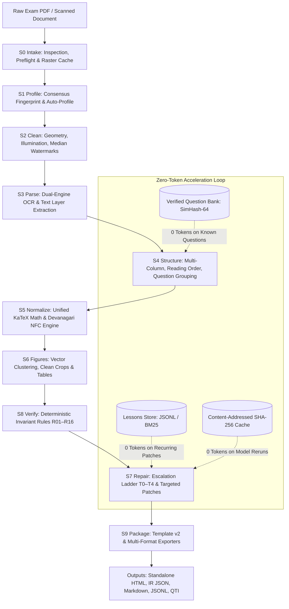
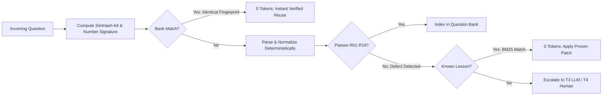
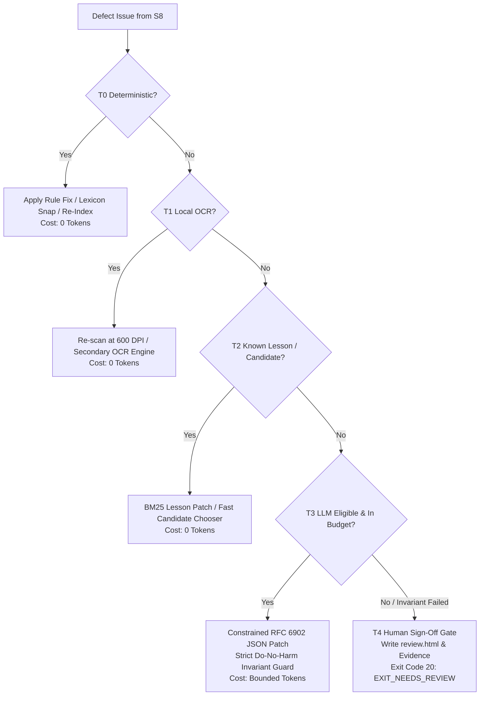

# ExamForge v2.0 — Complete Architecture & Component Map

ExamForge is an autonomous, token-efficient, deterministic exam paper reconstruction engine. It transforms raw, scanned, degraded, or digital Indian competitive exam papers (NEET-UG, JEE Main/Advanced, UPSC, GATE, CBSE, and State Boards) into clean, printable, accessible bilingual HTML documents and multi-format data artifacts — complete with KaTeX math, chemical formulas, vector diagrams, reconstructed tables, and rigorous automated invariants.

---

## 1. System Topology & Directed Acyclic Graph (DAG)

The pipeline is orchestrated by `src/examforge/orchestrator/` as a topologically sorted **Stage DAG** (`StageDAG` in `src/examforge/orchestrator/dag.py`). Every stage runs with atomic checkpoints, crash resilience, resource monitoring, and strictly scoped inputs/outputs.



---

## 2. How ExamForge Works: End-to-End Operational Lifecycle

ExamForge processes exam papers through a deterministic, fail-closed pipeline divided into 10 discrete stages. Below is the step-by-step walkthrough of how data moves from a raw PDF to production-grade reconstructed artifacts.

```mermaid
sequenceDiagram
    autonumber
    actor User as User / CLI
    participant S0 as S0 Intake
    participant S1 as S1 Profile
    participant S2 as S2 Clean
    participant S3 as S3 Parse
    participant S4 as S4 Structure
    participant S5 as S5 Normalize
    participant S6 as S6 Figures
    participant S8 as S8 Verify
    participant S7 as S7 Repair
    participant S9 as S9 Package

    User->>S0: Submit paper.pdf
    Note over S0: Preflight checks (bomb guards, encryption),<br/>extract metadata, render 300 DPI raster cache
    S0->>S1: Hand off PageInfo & rasters
    Note over S1: Analyze gutter geometry, script ratios,<br/>match profile (e.g. jee_adv) or auto-scaffold
    S1->>S2: Apply profile geometry & layout rules
    Note over S2: Deskew +/-15°, flatten illumination (Gaussian),<br/>median watermark subtraction, furniture removal
    S2->>S3: Cleaned image buffers & layout bands
    Note over S3: Extract digital text layer or invoke Paddle-VL OCR;<br/>emit word/line tokens with bounding boxes
    S3->>S4: Raw tokens & layout geometry
    Note over S4: Whitespace projection for columns, reading order,<br/>numbering regex match, question grouping,<br/>SimHash bank query for instant 0-token reuse
    S4->>S5: Grouped Questions & Options
    Note over S5: Single-pass KaTeX math wrapping, mhchem<br/>chemical formulas, Devanagari NFC, KrutiDev decoding,<br/>strict digit/unit multiset preservation
    S5->>S6: Normalized text, math & tables
    Note over S6: Vector path clustering (PyMuPDF Union-Find),<br/>border-strip ink-aware crops, figure binding,<br/>vector table grid reconstruction with crop fallback
    S6->>S8: Assembled ExamDocument
    Note over S8: Audit against 16 deterministic rules (R01-R16),<br/>generate defect ledger (issues.jsonl)
    S8->>S7: ExamDocument + Defect Issues
    Note over S7: Route issues through T0-T4 escalation ladder:<br/>T0 deterministic -> T1 local OCR -> T2 BM25 -> T3 JSON patch
    S7->>S9: Fully repaired, validated ExamDocument
    Note over S9: Render Jinja2 v2 template (offline CSP, KaTeX CSS),<br/>embed base64 figures, export JSON/Markdown/QTI
    S9->>User: Exit 0 (Success) / Exit 10 (Warnings) / Exit 20 (Review)
```

---

### Step 1: Ingestion & Safety Preflight (`s0_intake`)
- **File Safety Guard**: Validates that the input is a valid PDF or image archive. Rejects corrupt 0-byte files, password-protected/encrypted PDFs, and decompression bombs (>50 Megapixel uncompressed limit) to guarantee memory safety.
- **Metadata Extraction**: Reads document catalog, title, page dimensions, and page count.
- **Raster Cache**: Generates high-fidelity page images at 300 DPI (or profile-configured DPI) with on-disk caching (`src/examforge/raster_cache.py`), ensuring subsequent stages do not repeatedly re-render PDF pages.

### Step 2: Consensus Fingerprinting & Profiling (`s1_profile`)
- **Consensus Fingerprinting**: Samples multiple pages across the document to measure:
  1. Gutter geometry (whitespace distributions across vertical projection profiles).
  2. Language script distribution (ratio of Latin vs. Devanagari Unicode codepoints).
  3. Running header/footer band coordinates.
- **Profile Resolution**: Matches the fingerprint against built-in declarative profiles (`src/examforge/profiles/builtin/`):
  - `jee_advanced.yaml`, `jee_main.yaml`, `neet_ug.yaml`, `upsc_prelims.yaml`, `gate.yaml`, `cbse_board.yaml`, etc.
- **Auto-Profiling**: If `--profile auto` is specified and no profile matches with high confidence, `infer_rules.py` deterministically infers column counts, numbering formats, and option styles, scaffolding a candidate profile with ReDoS-safe regex validation.
- **Inheritance Resolution**: Resolves hierarchical YAML profiles via `extends:` (e.g., `jee_advanced` extends `base`), deep-merging defaults while preventing circular references.

### Step 3: Cleaning & Document Restoration (`s2_clean`)
- **Orientation & Deskew**: Detects orientation (0°, 90°, 180°, 270°) and computes skew angle via Radon transform / projection variance, correcting rotations within $\pm 15^\circ$.
- **Illumination Flattening**: Corrects lighting gradients, mobile scan shadows, and paper yellowing by dividing the original image by a heavily Gaussian-blurred background approximation (SSIM $\ge 0.95$).
- **Cross-Page Median Watermark Scrubbing**: Analyzes repeating background watermarks across pages. Since text and questions shift across pages while watermarks remain stationary, computing the per-pixel median across pages isolates the watermark, which is then subtracted from each page.
- **Furniture & Branding Scrubbing**: Masks running headers, page numbers (Arabic, Roman, Devanagari), test booklet codes, and commercial coaching URLs/phone numbers. Every dropped region is logged with bounding box coordinates and provenance under the **Zero Silent Loss** guarantee.

### Step 4: Dual-Engine Parsing & Extraction (`s3_parse`)
- **Digital-First Detection**: Checks if the PDF contains a clean native text layer. If available, digital text and character bounding boxes are extracted directly via PyMuPDF (`fitz`), bypassing OCR completely to eliminate transcription errors.
- **OCR Engine Execution**: For scanned or degraded pages, the system dispatches to the configured OCR engine (Paddle-VL / PP-OCR or PyTesseract fallback).
- **Token Fusion**: Merges text tokens, bounding boxes, font weights, and confidence scores into raw layout blocks.

### Step 5: Multi-Column Structuring & Reading Order (`s4_structure`)
- **Column Gutter Detection**: Evaluates vertical projection profiles to locate sustained whitespace gutters, segmenting pages into 1, 2, or 3 columns.
- **Reading Order Resolution**: Applies column-aware topological sorting (`parallel` for side-by-side bilingual papers, `columns_ltr` for English multi-column, or recursive `xy_cut`).
- **Question Numbering & Grouping**: Detects question headers using profile regexes protected against ReDoS and chemical formulas (ensuring expressions like $H_2O$ or question sub-points do not trigger false question breaks).
- **Association**: Groups question stems, options $(A)(B)(C)(D)$, subparts $(a)(b)(c)$, internal choice groups (`OR` / `अथवा`), assertion-reason blocks, and comprehension passages.
- **Zero-Token Bank Lookup**: Queries the SQLite Verified Question Bank using SimHash-64. If an exact match with identical numeral signatures is found, the verified representation is reused with 0 token consumption.

### Step 6: Unified Normalization (`s5_normalize`)
Consolidates mathematical and linguistic normalization into a single high-efficiency pass (Phase O3.4):
- **Single-Pass Question Traversal**: Traverses each question exactly once, eliminating redundant string traversals.
- **Mathematical Token Wrapping**: Converts Unicode math symbols ($\times, \div, \pm, \sqrt{}, \alpha, \beta, \theta, \int$) into standard LaTeX, wrapping them in KaTeX delimiters (`$...$`).
- **Chemical Formula Canonicalization**: Recognizes molecular formulas, oxidation states, and reaction arrows, formatting them using mhchem syntax (`\ce{...}`).
- **Negative Prose Protection**: Prevents ordinary English words or single variables in prose (like "a", "I", "m") from being mistakenly wrapped in math delimiters.
- **Devanagari Normalization**: Applies Unicode NFC normalization, converts ASCII danda/pipe characters to Unicode Purna Viram (`।`), and decodes legacy non-Unicode fonts (KrutiDev, Chanakya).
- **Do-No-Harm Invariant (O3.6)**: Strictly verifies that the multiset of numeric digits and scientific units is identical before and after normalization.

### Step 7: Vector Figures & Table Reconstruction (`s6_figures`)
- **Vector Path Extraction**: Directly extracts vector graphics paths (`fitz.get_drawings()`), lines, Bézier curves, and fills.
- **Union-Find Clustering**: Groups disjoint vector elements into unified diagram objects while filtering out page borders, decorative rules, and watermark vectors.
- **Raster Fallback & Clean Crops**: For scanned diagrams, connected components identify ink boundaries. The "grow-until-clean" policy iteratively expands crop bounding boxes until the perimeter border strip has zero ink, preventing severed arrowheads or truncated axis labels.
- **Table Reconstruction**: Detects horizontal and vertical ruling intersections to construct clean semantic grid tables (`TableNode`). If a table is degraded or unparseable, it safely falls back to a high-resolution `RawCropNode` (ensuring Zero Silent Loss).
- **Figure Association**: Associator greedily binds diagrams to the nearest relevant question based on geometric proximity and textual references (e.g., "See Figure 1", "चित्र में दर्शाए अनुसार").

### Step 8: Deterministic Invariant Verification (`s8_verify`)
The document is audited against **16 deterministic rules (R01–R16)** without subjective LLM opinions:
- Verifies completeness, formula validity, bilingual consistency, answer binding, and layout invariants.
- Compiles all warnings, blockers, and failures into an audited defect ledger (`issues.jsonl`).

### Step 9: Hierarchical Escalation Ladder (`s7_repair`)
Issues identified in Stage S8 are routed through the 5-tier escalation ladder:
- **T0 (Deterministic Fixes)**: Rule-based regex patches, lexicon typo snapping, and sequence gap re-indexing (Cost: 0 tokens).
- **T1 (Local Second Opinion)**: Re-rasterizes localized image crops at higher DPI and runs secondary OCR engine analysis (Cost: 0 tokens).
- **T2 (Lessons Store & Fast Selection)**: Queries the BM25 historical lessons store for proven previous patches, or uses cheap VLM candidate selection (Cost: 0 tokens / minimal compute).
- **T3 (Guarded LLM Patching)**: Invokes an LLM with minimal context (strict token/pixel budget) requesting a constrained RFC 6902 JSON patch. The patch is rejected if it alters numeric values, units, or option labels.
- **T4 (Human Review Gate)**: If an issue cannot be safely resolved deterministically or within budget, it is flagged for human sign-off in `review.html`. The pipeline exits with code `20` (`EXIT_NEEDS_REVIEW`) rather than emitting corrupted output.

### Step 10: Packaging & Multi-Format Exporters (`s9_package`)
- **Standalone HTML Output**: Compiles the complete exam into a self-contained single-file HTML document using Jinja2 (`exam_v2.html.j2`).
  - Offline Content Security Policy (`default-src 'none'; style-src 'unsafe-inline'; img-src data:`).
  - KaTeX CSS and fonts embedded inline or referenced locally.
  - Figures encoded as self-contained base64 data URIs.
  - Print-ready `@media print` layout and responsive side-by-side bilingual columns.
- **Multi-Format Exports**: Emits IR v2 JSON (`document.json`), Markdown (`output.md`), streaming JSONL questions (`questions.jsonl`), and IMS QTI XML (`qti.xml`).
- **Audit Manifest**: Saves `manifest.json` recording stage timings, memory RSS telemetry, rule audit logs, and token accounting.

---

## 3. Core Architectural Subsystems

### 3.1 Intermediate Representation (IR v2) & Invariants
- **Location**: `src/examforge/ir/`
- **Discriminated Union `ContentNode`**:
  A question body contains an ordered sequence of typed nodes:
  1. `TextNode`: Pure prose text with script and language annotations.
  2. `MathNode`: Inline or display LaTeX expressions with KaTeX delimiters.
  3. `TableNode`: Reconstructed semantic table grids with row/col spans.
  4. `FigureNode`: Crop reference, base64 data, caption, and geometry.
  5. `StatementsNode`: Multi-statement questions (e.g., Statement I and Statement II).
  6. `MatchColumnsNode`: Column-I vs Column-II matrix matching tables.
  7. `CodeNode`: Source code snippets with language syntax hints.
  8. `BlankNode`: Fill-in-the-blank placeholders.
  9. `RawCropNode`: High-resolution visual fallback for complex or degraded elements.
- **Invariants Enforcement (`invariants.py`)**:
  - Unique question and block IDs.
  - Monotonically increasing question numbering.
  - Valid option keys (`A`, `B`, `C`, `D` or `1`, `2`, `3`, `4`).
  - Answer key referential integrity.

### 3.2 Declarative Exam Profiles
- **Location**: `src/examforge/profiles/`
- **Profile Schema (`schema.py`)**: Pydantic model defining:
  - Language pair and primary reading direction.
  - Column count and gutter geometry tolerances.
  - Question numbering regexes and choice indicators.
  - Marking scheme (+4, -1, 0) and section distributions.
  - Header, footer, and furniture exclusion zones.
- **Built-in Profiles**: `neet_ug`, `jee_main`, `jee_advanced`, `upsc_prelims`, `gate`, `cbse_board`, `sat_like`, `generic_bilingual`, `generic_mono`.

### 3.3 Zero-Token Acceleration Engine
ExamForge drastically reduces LLM API costs through three interlocking caching layers:
1. **Verified Question Bank (`src/examforge/bank/`)**:
   - SQLite database operating in WAL mode.
   - Computes 64-bit SimHash fingerprints and strict numeral signatures (`compute_number_signature`).
   - If an incoming question matches an existing verified question in hash and numeral signature, it is reused with **zero token cost**.
2. **Lessons Store (`src/examforge/lessons/`)**:
   - Append-only JSONL storage of verified repairs and patches.
   - Uses BM25 text retrieval to look up how similar OCR corruptions or broken formulas were repaired in past runs.
3. **Content-Addressed Cache (`src/examforge/llm/cache.py`)**:
   - SHA-256 hash of prompt, temperature, and schema keys all LLM requests, preventing duplicate queries.



---

## 4. Deterministic Invariant Verifier Suite (R01–R16)

The verification stage (`s8_verify`) executes 16 independent, deterministic rule validators located in `src/examforge/validators/`:

| Rule ID | Rule Name | Validator Class | What It Checks | Failure Threshold / Action |
|:---:|:---|:---|:---|:---|
| **R01** | No Furniture | `R01NoFurniture` | Ensures running headers, footers, and page numbers are eliminated from content blocks. | Blocker if repeating headers/footers appear in question stems. |
| **R02** | No Branding | `R02NoBranding` | Detects coaching institute watermarks, phone numbers, website URLs, and promotional banners. | Blocker if promotional URLs or coaching watermarks persist. |
| **R03** | No Watermark | `R03NoWatermark` | Measures residual watermark correlation across page backgrounds after median subtraction. | Warning if correlation coefficient $> 0.05$. |
| **R04** | Continuous Flow | `R04Continuous` | Verifies that question text flows across column and page boundaries without orphan fragments. | Blocker if disconnected sentence fragments are found. |
| **R05** | Bilingual Consistency | `R05Bilingual` | Checks that bilingual papers maintain 1:1 question-level English and Hindi correspondence. | Blocker if a question has an English stem but missing Hindi counterpart. |
| **R06** | Complete Questions | `R06Complete` | Verifies that questions have a non-empty stem and the expected option count (typically 4 choices). | Blocker if choices are missing or empty. |
| **R07** | Formulas & Notation | `R07Formulas` | Validates KaTeX syntax, balanced brackets, valid LaTeX operators, and balanced chemical equations. | Blocker if KaTeX fails to parse expression syntax. |
| **R08** | Figures & Images | `R08Figures` | Checks that referenced diagrams exist, are within aspect ratio bounds, and meet resolution limits. | Blocker if figure reference cannot be resolved. |
| **R09** | Unicode Health | `R09Unicode` | Enforces Devanagari Unicode NFC normalization, correct matra ordering, and Purna Viram (`।`). | Blocker if corrupted non-NFC codepoints or font glyphs remain. |
| **R10** | Language Invariant | `R10LanguageConsistency` | Verifies that numbers, quantities, and units match identically between English and Hindi versions. | Blocker if $50\text{ m/s}$ in English is transcribed as $5\text{ m/s}$ in Hindi. |
| **R11** | Text Layer Agreement | `R11TextLayerAgreement` | Cross-checks OCR extracted tokens against the PDF digital text layer when available. | Warning if token overlap falls below 95%. |
| **R12** | STEM Lexicon | `R12Lexicon` | Audits vocabulary against specialized STEM dictionaries (Physics, Chemistry, Biology, Math). | Warning on unrecognized technical terms; triggers T0 spell-snap. |
| **R13** | Render Check | `R13RenderCheck` | Validates that KaTeX math renders cleanly without producing browser error containers. | Blocker if render generates `.katex-error` spans. |
| **R14** | Sequence Gaps | `R14SequenceGaps` | Checks question numbering for strict monotonicity and detects missing or duplicated questions. | Blocker if sequence skips (e.g. Q12 followed immediately by Q14). |
| **R15** | Structure Consistency | `R15StructureConsistency` | Validates nesting integrity for subparts `(a)(b)(c)` and internal choice options (`OR`/`अथवा`). | Blocker if orphan sub-options lack a parent stem. |
| **R16** | Answer Binding | `R16AnswerBinding` | Validates that answer keys bind to existing question IDs and match option kinds. | Blocker if answer key references non-existent question ID. |

---

## 5. Escalation Repair Ladder (T0–T4)

When Stage S8 registers defects, Stage S7 routes them through the **T0–T4 Escalation Ladder** (`src/examforge/repair/router.py`):



1. **T0 — Deterministic Auto-Fix**: Executes rule-specific repairs such as regex substitution, lexicon snapping, and gap re-indexing without external calls.
2. **T1 — Local OCR Second Opinion**: Re-crops the problematic bounding box at higher DPI and runs secondary OCR (e.g. Tesseract vs. Paddle).
3. **T2 — Lessons Store / Candidate Chooser**: Queries historical repair patterns from `lessons/store.py` via BM25 ranking.
4. **T3 — Guarded LLM JSON Patch**: Invokes an LLM with minimal context. The response must be a valid RFC 6902 JSON patch and is strictly checked against the **Do-No-Harm Invariant** (it cannot alter numbers or scientific units).
5. **T4 — Human Review Gate**: If an issue remains unresolved or exceeds token budget, it is written to `runs/<run_id>/review.html` with side-by-side original crops and candidate text.

---

## 6. Exit Codes & Operational Semantics

ExamForge CLI commands return standard exit codes enabling integration into automated pipelines:

| Exit Code | Constant | Meaning | Operational Action |
|:---:|:---|:---|:---|
| **0** | `EXIT_OK` | All stages passed; all blocker rules satisfied. | Output HTML and data artifacts in `runs/<run_id>/` are ready for production. |
| **10** | `EXIT_WARNINGS` | Pipeline completed; non-blocking warnings detected (e.g. slight watermark residual or lexicon anomaly). | Output is complete and usable. Warnings logged in `manifest.json`. |
| **20** | `EXIT_NEEDS_REVIEW` | Pipeline completed with disputed blocks or escalated repairs requiring human approval. | Launch `review.html` to inspect evidence and approve or modify proposed patches. |
| **30** | `EXIT_FAILED` | Fatal error, image bomb, unrecoverable PDF corruption, or hard invariant violation. | Pipeline halted. Check `manifest.json` and stage logs for root cause. |

---

## 7. Complete Source File Directory Map

| Directory / Module | Key Files | Responsibility |
|:---|:---|:---|
| `src/examforge/` | `__init__.py`, `cli.py`, `config.py`, `spec.py`, `telemetry.py`, `registry.py` | Package root, Click CLI commands, global configuration, verification spec rules, runtime memory & timing telemetry. |
| `src/examforge/orchestrator/` | `dag.py`, `runner.py`, `io.py`, `robustness.py`, `plugins.py`, `logging.py`, `manifest.py` | Stage DAG dependency resolver, crash-resilient runner, atomic fsync I/O, image-bomb preflight guards, plugin host, audit manifests. |
| `src/examforge/stages/` | `base.py`, `s0_intake.py`, `s1_profile.py`, `s2_clean.py`, `s3_parse.py`, `s4_structure.py`, `s5_normalize.py`, `s6_figures.py`, `s7_repair.py`, `s8_verify.py`, `s9_package.py` | The 10 discrete pipeline execution stages. |
| `src/examforge/ir/` | `schema.py`, `invariants.py`, `migrator.py` | Discriminated union `ContentNode` IR v2, structural invariant validators, and backward-compatible v1/v2 schema migration. |
| `src/examforge/profiles/` | `schema.py`, `loader.py`, `fingerprint.py`, `infer_rules.py`, `infer_llm.py`, `scaffold.py`, `compute.py`, `builtin/*.yaml` | Declarative exam profiles, document consensus fingerprinting, auto-profiling engine, compute tiers (`lite`, `standard`, `gpu`). |
| `src/examforge/clean/` | `geometry.py`, `illumination.py`, `watermark_median.py`, `furniture.py`, `branding.py` | Radon deskew, Gaussian illumination flattening, cross-page median watermark subtraction, running furniture & coaching branding scrubbers. |
| `src/examforge/layout/` | `columns.py`, `reading_order.py`, `numbering.py`, `nesting.py`, `passages.py`, `kinds.py`, `parts.py`, `redos.py` | Whitespace projection profile column detection, reading order graphs, ReDoS-safe regex engine, passage binding, question kind heuristics. |
| `src/examforge/notation/` | `tokenizer.py`, `canonical.py`, `chemistry.py`, `wrapping.py`, `validation.py` | Math & chemical notation tokenization, Unicode-to-LaTeX canonicalization, mhchem formatting, negative prose protection. |
| `src/examforge/lang/` | `registry.py`, `bilingual.py`, `fontmaps.py`, `rtl.py`, `plugins/` | Script plugins (`en`, `hi`), Devanagari NFC normalizer, legacy KrutiDev/Chanakya font decoding, RTL script support. |
| `src/examforge/figures/` | `vector.py`, `raster.py`, `crop.py`, `associate.py`, `resolution.py`, `cleanup.py` | PyMuPDF vector drawing path clustering (Union-Find), border-strip zero-ink crop refinement, greedy figure-to-question association. |
| `src/examforge/tables/` | `grid.py`, `vector.py`, `pipeline.py` | Vector ruling intersection analysis, cell grid reconstruction, Zero Silent Loss fallback to `RawCropNode`. |
| `src/examforge/validators/` | `base.py`, `registry.py`, `r01` through `r16` | 16 deterministic invariant rules auditing furniture, branding, watermarks, completeness, formulas, bilingual parity, and sequence gaps. |
| `src/examforge/repair/` | `router.py`, `context.py`, `patch.py`, `gap_search.py`, `ledger.py` | T0–T4 escalation repair ladder, minimal context assembler, RFC 6902 JSON patch executor with digit-preservation guard. |
| `src/examforge/bank/` | `store.py`, `fingerprint.py`, `match.py`, `ingest.py` | SQLite WAL verified question bank, 64-bit SimHash indexing, strict numeral & unit signature matching for 0-token reuse. |
| `src/examforge/lessons/` | `store.py`, `retrieve.py`, `promote.py` | Append-only JSONL repair lessons, BM25 similarity retrieval for 0-token recurring patches, automated promotion to rule scaffolds. |
| `src/examforge/llm/` | `client.py`, `budget.py`, `cache.py`, `fake.py`, `recording.py`, `types.py` | Strict LLM abstraction seam, token budget governor, content-addressed SHA-256 prompt cache, mock & recording test fixtures. |
| `src/examforge/export/` | `base.py`, `html.py`, `json.py`, `markdown.py`, `jsonl.py`, `qti.py`, `registry.py` | Standalone single-file HTML exporter, IR v2 JSON exporter, Markdown with KaTeX exporter, streaming JSONL exporter, IMS QTI XML exporter. |
| `src/examforge/templates/` | `exam.html.j2`, `exam_v2.html.j2` | Jinja2 templates with macros for all 9 ContentNode kinds, greedy option grid packing (`opt-grid-2`, `opt-grid-4`), and offline CSP styling. |
| `src/examforge/answers/` | `parse_key.py`, `bind.py`, `marks.py`, `solutions.py` | Answer key extraction, question binding, marking scheme computation (+4/-1), step-by-step solution association. |
| `src/examforge/eval/` | `metrics.py`, `scorer.py`, `compare.py` | Evaluation metrics (CER, WER, Bounding-Box IoU, TEDS table score), automated benchmark ratchet suite. |
| `src/examforge/perf/` | `ratchet.py` | Performance and latency benchmark ratchets protecting against throughput regressions. |
| `src/examforge/synth/` | `generator.py`, `degrade.py`, `figures.py`, `matrix.py` | Synthetic degraded exam paper generation for robust fault-injection testing. |
