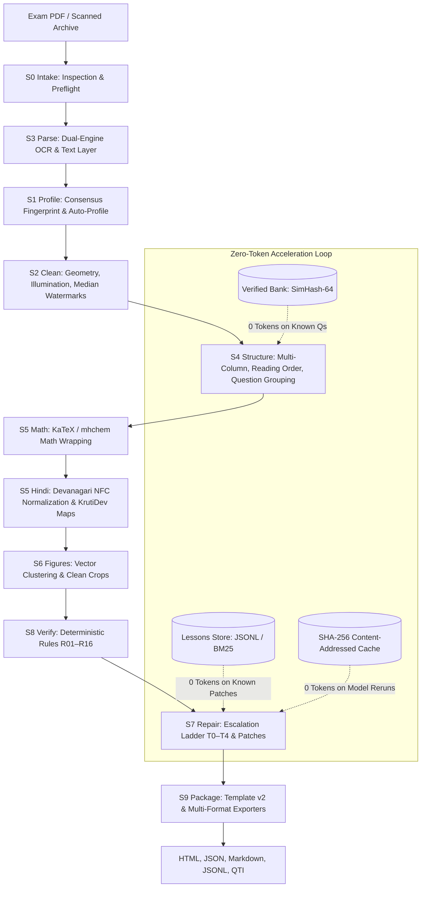

# ExamForge v2.0 — Complete Architecture & Component Map

ExamForge is an autonomous, token-efficient, deterministic exam paper reconstruction pipeline designed to transform raw, scanned, degraded, or digital Indian competitive exam papers into clean, printable, accessible bilingual HTML documents and multi-format data artifacts.

---

## 1. System Topology & Directed Acyclic Graph (DAG)

The pipeline is coordinated by `src/examforge/orchestrator/` as a topologically sorted Directed Acyclic Graph (DAG) consisting of 11 sequential stages with atomic checkpoints, crash-resilience, and capability negotiation.

---

## 2. Core Subsystems & Components

### 2.1 Intermediate Representation (IR v2) & Invariants
- **Directory**: `src/examforge/ir/`
- **Modules**:
  - `schema.py`: Discriminated union `ContentNode` model (`TextNode`, `MathNode`, `TableNode`, `FigureNode`, `StatementsNode`, `MatchColumnsNode`, `CodeNode`, `BlankNode`, `RawCropNode`), `Question`, `Option`, `Passage`, `ExamDocument`.
  - `invariants.py`: Invariant enforcement (ID uniqueness, reference resolution, monotone numbers, option label validity, choice group marks).
  - `migrator.py`: Lossless bi-directional migration from v1 `document.json` to v2 schema (`migrate_v1_to_v2`, `load_document`).

### 2.2 Declarative Exam Profiles & Auto-Profiling
- **Directory**: `src/examforge/profiles/`
- **Modules**:
  - `schema.py`: Pydantic `ExamProfile` schema (languages, layout, numbering regexes, options, marking schemes, furniture rules).
  - `loader.py`: Profile loader supporting multi-level inheritance (`extends`), deep merging, and cycle detection.
  - `fingerprint.py`: Document consensus fingerprinting (gutter geometry, Unicode script ratios, header band hashes).
  - `infer_rules.py`: Deterministic rule inference (columns, numbering regexes, option schemes).
  - `infer_llm.py`: Guarded one-shot LLM profile completion with ReDoS validation.
  - `scaffold.py`: Auto-scaffolding generator emitting YAML draft profiles under `profiles/learned/`.
  - `compute.py`: Compute tier specifications (`lite`, `standard`, `gpu`).
  - `builtin/`: Builtin profiles (`neet_ug.yaml`, `jee_main.yaml`, `jee_advanced.yaml`, `upsc_prelims.yaml`, `gate.yaml`, `cbse_board.yaml`, `sat_like.yaml`, `generic_mono.yaml`, `generic_bilingual.yaml`, `base.yaml`).

### 2.3 Orchestrator, CLI & Runner Hardening
- **Directory**: `src/examforge/orchestrator/` & root
- **Modules**:
  - `cli.py`: Click CLI commands (`execute`, `resume`, `inspect`, `doctor`, `plugins`, `schema`, `profile`, `bank`, `lessons`, `eval`).
  - `dag.py`: Stage DAG with dependency sorting, partial execution (`--from-stage`, `--to-stage`, `--only`), and cycle detection.
  - `runner.py`: Sequential pipeline runner with atomic checkpointing, resume recovery, and exit code resolution (0, 10, 20, 30).
  - `io.py`: Atomic writes with `fsync`, cross-platform exclusive run locking (`RunLock`), and path sanitization.
  - `robustness.py`: Preflight guard against 50MP image bombs, encrypted PDFs, corrupt 0-byte files, and ZIP image unpacker.
  - `plugins.py`: Plugin discovery, API version compatibility guards, and execution isolation.
  - `logging.py`: Structured JSON logging with automated redaction of API keys, tokens, and credentials.
  - `manifest.py`: Atomic manifest recording stage metrics, memory, and timings.

### 2.4 Multi-Column Layout & Structure Engine
- **Directory**: `src/examforge/layout/`
- **Modules**:
  - `columns.py`: Whitespace projection profile variance, sustained gutter detection, and full-width span classification.
  - `reading_order.py`: Multi-strategy reading order (`parallel`, `columns_ltr`, `columns_rtl`, `xy_cut`).
  - `languages.py`: Multi-lingual column and interleaved layout alignment.
  - `numbering.py`: Profile-driven numbering regexes, chemical formula protection, and monotonicity sequence checks.
  - `nesting.py`: Subpart nesting `(a)(b)(c)` and internal choice group (`OR`/`अथवा`) detection.
  - `passages.py`: Range-based comprehension passage detection and question association.
  - `kinds.py`: Deterministic question-kind classification heuristic (MCQ, integer, assertion-reason, match column).
  - `orientation.py` & `parts.py`: Two-up spread splitting and document part classification (cover, instructions, questions, rough work).
  - `redos.py`: Safe regex timeout and chunking compiler protecting against ReDoS attacks.

### 2.5 Vector-First Figures & Table Reconstruction
- **Directory**: `src/examforge/figures/` & `src/examforge/tables/`
- **Modules**:
  - `figures/vector.py`: PyMuPDF `get_drawings()` union-find path clustering and watermark vector filtering.
  - `figures/raster.py`: Connected-component run-length clustering for raster scans.
  - `figures/crop.py`: Border-strip ink ratio refinement (grow-until-clean border-strip ink == 0).
  - `figures/associate.py`: Constrained greedy figure-to-question association.
  - `figures/resolution.py`: Clamped native DPI resolution policy (`img-inline` to `img-lg`).
  - `figures/cleanup.py`: Photocopier black-border and punch-hole margin removal.
  - `tables/grid.py`, `tables/vector.py`, `tables/pipeline.py`: Vector rulings to grid reconstruction with `RawCropNode` fallback (Zero Silent Loss).

### 2.6 Restoration & Cleaning Engine
- **Directory**: `src/examforge/clean/`
- **Modules**:
  - `geometry.py`: 0/90/180/270 orientation detection and +/-15° projection profile deskew.
  - `illumination.py`: Heavy Gaussian blur flat-field division shadow flattening (SSIM >= 0.95).
  - `watermark_median.py`: Cross-page per-pixel median watermark extraction and flat-field subtraction (R03 < 0.05).
  - `furniture.py`: Script-aware page number detection (Arabic, Devanagari, Roman) and repeating furniture clustering.
  - `branding.py`: Commercial coaching URL and phone number scrubbing with scientific constant protection.

### 2.7 Domain Lexicons, Math & Script Plugins
- **Directory**: `src/examforge/lang/` & `src/examforge/notation/`
- **Modules**:
  - `lang/registry.py`: `ScriptPlugin` protocol and registry.
  - `lang/plugins/`: `en.py` (English), `hi.py` (Hindi), `scaffolded.py` (Tamil, Telugu, Bengali, Gujarati, etc.).
  - `lang/fontmaps.py`: Legacy KrutiDev / Chanakya glyph mapping and transliteration.
  - `lang/bilingual.py` & `lang/rtl.py`: Unicode block segmentation and bidirectional text handling.
  - `notation/tokenizer.py` & `canonical.py`: Unicode math to LaTeX canonicalization, Greek symbols, and SI unit protection.
  - `notation/chemistry.py`: Chemical formula balancing, oxidation states, and mhchem KaTeX formatting.
  - `notation/wrapping.py` & `validation.py`: Token math wrapping with negative prose protection (`x`, `2`, `m` unwrapped).

### 2.8 Deterministic Verifiers (R01–R16)
- **Directory**: `src/examforge/validators/`
- **Rules**:
  - `r01_no_furniture.py`: Header/footer furniture elimination.
  - `r02_no_branding.py`: Commercial branding scrubbing.
  - `r03_no_watermark.py`: Watermark residual correlation check (<0.05).
  - `r04_continuous.py`: Continuous stream flow verification.
  - `r05_bilingual.py`: Bilingual question-level pairing.
  - `r06_complete.py`: Completeness of question stems and options.
  - `r07_formulas.py`: KaTeX / mhchem syntax and equation balance.
  - `r08_figures.py`: Figure resolution and crop aspect ratio bounds.
  - `r09_unicode.py`: Devanagari NFC health and Purna Viram validation.
  - `r10_language_consistency.py`: Cross-lingual invariant numeric token agreement.
  - `r11_text_layer_agreement.py`: Text layer ground truth token overlap.
  - `r12_lexicon.py`: STEM domain vocabulary and OCR typo detection.
  - `r13_render_check.py`: KaTeX rendering error and container artifact check.
  - `r14_sequence_gaps.py`: Monotone question sequence and gap detection.
  - `r15_structure_consistency.py`: Subpart nesting and choice group integrity.
  - `r16_answer_binding.py`: Answer key referential integrity and kind compatibility.

### 2.9 Escalation Ladder & Repair (S7)
- **Directory**: `src/examforge/repair/` & `src/examforge/confidence/`
- **Modules**:
  - `confidence/calibrate.py`: Platt scaling confidence calibration across OCR, text layer, and rule evidence.
  - `repair/router.py`: Hierarchical repair tier routing (T0 deterministic -> T1 local OCR -> T2 VLM index -> T3 JSON patch -> T4 human).
  - `repair/context.py`: Minimal context builder with strict token and pixel caps.
  - `repair/patch.py`: Constrained RFC 6902 JSON patch applier with digit-preservation guard.
  - `repair/gap_search.py`: Targeted gap re-search for missing questions.

### 2.10 Verified Question Bank & Self-Improving Loop
- **Directory**: `src/examforge/bank/` & `src/examforge/lessons/`
- **Modules**:
  - `bank/store.py`: SQLite WAL-mode question storage, SimHash indexing, and import/export.
  - `bank/fingerprint.py`: SimHash-64 with strict numeral signatures (`compute_number_signature`) and image dHash.
  - `bank/match.py`: Invariant matching blocking `EXACT_REUSE` if numerals, units, or option counts differ.
  - `bank/ingest.py`: Question ingestion pipeline with audit provenance.
  - `lessons/store.py`: Append-only JSONL lesson storage with locking and compaction.
  - `lessons/retrieve.py`: BM25-style scoring for 0-token recurring repair retrieval.
  - `lessons/promote.py`: Automated recurrence threshold promotion into rule scaffolds.

### 2.11 Exporters & Templating
- **Directory**: `src/examforge/export/` & `src/examforge/templates/`
- **Modules**:
  - `templates/exam_v2.html.j2`: Jinja2 template with macros for 9 ContentNode kinds, greedy option packing (`opt-grid-2`, `opt-grid-4`), and offline CSP.
  - `export/html.py`: Standalone single-file HTML exporter with embedded base64 figures.
  - `export/json.py`: IR v2 JSON exporter.
  - `export/markdown.py`: Markdown exporter with KaTeX blocks.
  - `export/jsonl.py`: Streaming questions dataset exporter.
  - `export/qti.py`: IMS QTI-lite XML exporter with unsupported feature sidecar report.
  - `export/registry.py`: Exporter registry with capability discovery.

---

## 3. Complete Source File Directory Map

| Path | Primary Module / File | Responsibility |
|---|---|---|
| `src/examforge/` | `__init__.py` | Version export (`2.0.0`), core class re-exports |
| `src/examforge/` | `cli.py` | Click CLI application entry point and commands |
| `src/examforge/` | `config.py` | Layered settings, compute tiers, feature flag management |
| `src/examforge/` | `registry.py` | Generic typed `Registry[T]` pattern |
| `src/examforge/` | `spec.py` | Verification spec rules, `compute_spec_hash()` |
| `src/examforge/` | `telemetry.py` | Memory RSS, stage timing, and token accounting |
| `src/examforge/answers/` | `parse_key.py`, `bind.py`, `marks.py`, `solutions.py` | Answer key parsing, question binding, marking schemes |
| `src/examforge/bank/` | `store.py`, `fingerprint.py`, `match.py`, `ingest.py` | SimHash-64 question store, numeral signatures, 0-token reuse |
| `src/examforge/clean/` | `geometry.py`, `illumination.py`, `watermark_median.py`, `furniture.py`, `branding.py` | Deskew, shadow flattening, median watermarks, furniture filtering |
| `src/examforge/confidence/` | `calibrate.py` | Platt scaling multi-signal confidence calibration |
| `src/examforge/engines/` | `paddle_vl.py` | Paddle-VL 1.6 & PP-OCR multi-modal OCR engine adapter |
| `src/examforge/eval/` | `metrics.py`, `scorer.py`, `compare.py` | CER/WER/IoU/TEDS metrics, universal benchmark scoring |
| `src/examforge/export/` | `base.py`, `html.py`, `json.py`, `markdown.py`, `jsonl.py`, `qti.py`, `registry.py` | Multi-format exporters and registry |
| `src/examforge/figures/` | `vector.py`, `raster.py`, `crop.py`, `associate.py`, `resolution.py`, `cleanup.py` | Drawing vector paths, ink-aware border crops, figure association |
| `src/examforge/ir/` | `schema.py`, `invariants.py`, `migrator.py` | Discriminated union IR v2, invariants, v1-to-v2 migrator |
| `src/examforge/lang/` | `registry.py`, `bilingual.py`, `fontmaps.py`, `rtl.py`, `plugins/` | Script plugins (en, hi, scaffolded), KrutiDev font decoding |
| `src/examforge/layout/` | `columns.py`, `reading_order.py`, `numbering.py`, `nesting.py`, `passages.py`, `kinds.py`, `parts.py`, `redos.py` | Multi-column whitespace projection, reading order, ReDoS guard |
| `src/examforge/lessons/` | `store.py`, `retrieve.py`, `promote.py` | Self-improving loop, BM25 retrieval, rule promotion |
| `src/examforge/llm/` | `client.py`, `budget.py`, `cache.py`, `fake.py`, `recording.py`, `types.py` | Isolated LLM seam, token budget governor, prompt cache |
| `src/examforge/notation/` | `tokenizer.py`, `canonical.py`, `chemistry.py`, `wrapping.py`, `validation.py` | Math & chemical notation, KaTeX/mhchem wrapping |
| `src/examforge/orchestrator/`| `dag.py`, `runner.py`, `io.py`, `robustness.py`, `plugins.py`, `logging.py`, `manifest.py` | Formal Stage DAG, atomic I/O, run locks, bomb preflight |
| `src/examforge/profiles/` | `schema.py`, `loader.py`, `fingerprint.py`, `infer_rules.py`, `infer_llm.py`, `scaffold.py`, `compute.py`, `builtin/` | Exam profiles, consensus fingerprint, auto-profiling |
| `src/examforge/repair/` | `router.py`, `context.py`, `patch.py`, `gap_search.py` | Escalation ladder (T0–T4), minimal context, JSON patch |
| `src/examforge/stages/` | `base.py`, `s0_intake.py` through `s9_package.py` | 11 sequential pipeline execution stages |
| `src/examforge/tables/` | `grid.py`, `vector.py`, `pipeline.py` | Vector table ruling reconstruction, Zero Silent Loss |
| `src/examforge/templates/`| `exam.html.j2`, `exam_v2.html.j2` | Jinja2 templates, option grids, offline CSP |
| `src/examforge/validators/`| `base.py`, `registry.py`, `r01`–`r16` | 16 deterministic invariant and consistency rules |
